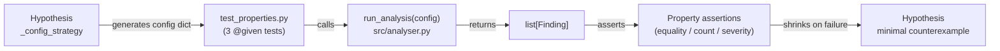

# Design Document

## Overview

This design covers the property-based test suite in `tests/test_properties.py` that verifies three correctness properties of the existing `run_analysis` function in `src/analyser.py`. No new source files, no application code changes, and no new dependencies are introduced. The existing tests already satisfy the requirements as written; this document formalises their structure, the Hypothesis strategy used, and the assertion requirements per the acceptance criteria.

---

## Architecture



---

## Components and Interfaces

### Hypothesis Configuration Strategy

All three tests share `_config_strategy`, defined in `tests/test_properties.py` as:

```python
_config_strategy = st.fixed_dictionaries({
    "mfa_enabled":        st.booleans(),
    "default_credentials": st.booleans(),
    "open_ports":         st.lists(st.integers(min_value=1, max_value=65535), max_size=10),
    "public_endpoint":    st.booleans(),
    "tls_enabled":        st.booleans(),
    "tls_version":        st.sampled_from(["1.0", "1.1", "1.2", "1.3"]),
    "storage_encrypted":  st.booleans(),
    "audit_log_enabled":  st.booleans(),
    "os_version":         st.sampled_from([
        "Ubuntu 22.04", "Ubuntu 20.04", "Ubuntu 18.04", "CentOS 7", "Windows Server 2022",
    ]),
})
```

`st.fixed_dictionaries` guarantees every generated config has all keys with valid types, exercising all five checker functions (`_check_auth`, `_check_network`, `_check_encryption`, `_check_logging`, `_check_patching`).

---

### Property: Idempotency (REQ-1)

**Test function:** `test_property_idempotency`  
**Strategy:** `_config_strategy` (single config drawn once, passed twice)  
**Assertion:** `result1 == result2`  
**Failure message:** reports both `result1` and `result2` lists  
**Settings:** `@settings(max_examples=50)`

The two `run_analysis` calls use the same dict reference; since `run_analysis` has no observable side effects, list equality (order, length, field values) must hold.

---

### Property: Monotonicity (REQ-2)

**Test function:** `test_property_monotonicity`  
**Strategy:** `_config_strategy` (base config drawn once)  
**Mutation:** shallow copy of config with `mfa_enabled=False` and `storage_encrypted=False` overridden  
**Assertion:** `len(run_analysis(modified)) >= len(run_analysis(config))`  
**Failure message:** reports original/modified configs and their respective finding counts  
**Settings:** `@settings(max_examples=50)`

Setting both keys simultaneously is strictly stronger than testing each in isolation: if either mutation increases findings, the count can only stay equal or grow.

---

### Property: Severity Membership (REQ-3)

**Test function:** `test_property_severity_membership`  
**Strategy:** `_config_strategy`  
**Assertion:** `finding.severity in set(Severity)` for every finding in the result  
**Failure message:** reports the offending `control_id` and invalid `severity` value  
**Settings:** `@settings(max_examples=50)`

`set(Severity)` is computed once per test invocation from the live enum, so the test stays correct if new severity levels are added.

---

## Data Models

No changes. Reference only:

- **`Finding`** — frozen dataclass with fields `control_id: str`, `title: str`, `severity: Severity`, `description: str`, `remediation: str` (in `src/analyser.py`)
- **`Severity`** — `str` enum with members `CRITICAL`, `HIGH`, `MEDIUM`, `LOW`, `INFO`; ordered by `SEVERITY_ORDER` dict
- **`run_analysis`** — `(config: dict[str, object]) -> list[Finding]`, deduplicated and sorted by `SEVERITY_ORDER`

---

## Correctness Properties

*A property is a characteristic or behavior that should hold true across all valid executions of a system — essentially, a formal statement about what the system should do. Properties serve as the bridge between human-readable specifications and machine-verifiable correctness guarantees.*

### Property 1: Idempotency

*For any* valid Configuration, calling `run_analysis` twice with the same Configuration SHALL return identical Finding lists (same length, same `control_id` values, same `severity` values, same order).

**Validates: Requirements 1.1**

---

### Property 2: Monotonicity under weakening

*For any* Configuration, overriding `mfa_enabled` to `False` and `storage_encrypted` to `False` (all other keys unchanged) SHALL produce a Finding count greater than or equal to the original count.

**Validates: Requirements 2.1, 2.2**

---

### Property 3: Severity membership invariant

*For any* valid Configuration, every Finding returned by `run_analysis` SHALL have a `severity` field that is a member of the `Severity` enum.

**Validates: Requirements 3.1**

---

## Error Handling

Hypothesis automatically shrinks failing inputs to a minimal counterexample. Each assertion message must satisfy the acceptance criteria:

| Property | Required failure message content |
|---|---|
| Idempotency (REQ-1.3) | Both `result1` and `result2` Finding lists |
| Monotonicity (REQ-2.4) | Original config, mutated config, original count, mutated count |
| Severity membership (REQ-3.3) | Offending `control_id` and the invalid `severity` value |

No custom `@reproduce_failure` decorator is needed; Hypothesis stores the database entry automatically.

---

## Testing Strategy

**Run the property tests:**
```
pytest tests/test_properties.py -v
```

**Expected output (all pass):**
```
tests/test_properties.py::test_property_idempotency         PASSED
tests/test_properties.py::test_property_monotonicity        PASSED
tests/test_properties.py::test_property_severity_membership PASSED
```

**On failure:** Hypothesis prints the minimal shrunk counterexample and the assertion message. The `@settings(max_examples=50)` decorator on each test satisfies the ≥50 iterations requirement from REQ-1.2, REQ-2.3, and REQ-3.2.

**PBT library:** [Hypothesis](https://hypothesis.readthedocs.io/) (already in `requirements.txt` at `hypothesis==6.131.6`). No property test is implemented from scratch.

Each test references its design property via its docstring:
- `test_property_idempotency` → **Feature: security-analysis-correctness, Property 1: Idempotency**
- `test_property_monotonicity` → **Feature: security-analysis-correctness, Property 2: Monotonicity under weakening**
- `test_property_severity_membership` → **Feature: security-analysis-correctness, Property 3: Severity membership invariant**
